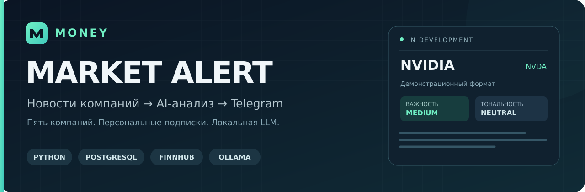
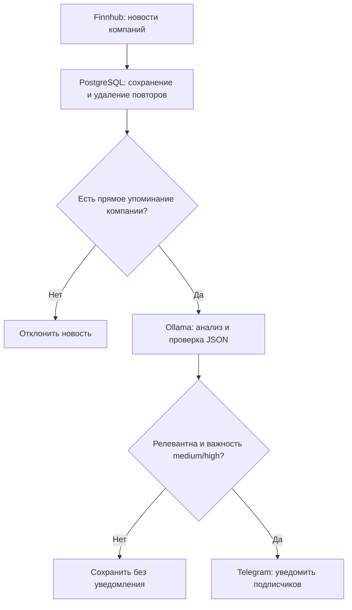

<p align="center">
  
</p>

# MONEY Market Alert

**Новостной Telegram-бот с локальным AI-анализом.** Пользователь выбирает компании, а приложение собирает новости, проверяет их релевантность и формирует краткие уведомления о значимых событиях.

**Статус: в разработке · прототип MVP**

Python · PostgreSQL · Finnhub · Ollama · Telegram Bot API

[Архитектура](docs/architecture.md) · [Документация](docs/README.md) · [План развития](docs/roadmap.md) · [Работа с ветками](CONTRIBUTING.md)

## Зачем нужен проект

В новостном потоке встречаются повторы, общие обзоры рынка и косвенные упоминания компаний. MONEY Market Alert объединяет сбор данных, хранение в PostgreSQL, структурированный анализ LLM и персональные подписки, чтобы превращать этот поток в понятные уведомления.

Проект включает программную реализацию и аналитические материалы: use cases, user stories, границы MVP, модель данных, BPMN-процесс и дерево функций.

## Возможности MVP

| Возможность | Реализация |
| --- | --- |
| Подписки на компании | Меню Telegram-бота; выбор сохраняется в PostgreSQL |
| Сбор новостей | Finnhub Company News; повторные записи отсекаются по внешнему ID |
| Проверка релевантности | Упоминание компании в тексте и последующая оценка LLM |
| Структурированный анализ | Релевантность, тональность, важность, краткое содержание и объяснение |
| Персональные уведомления | События средней и высокой важности для активных подписчиков |
| Учёт доставки | Статусы `pending`, `sent`, `failed` и резервирование перед отправкой |

Текущий список компаний: **Tesla / TSLA, NVIDIA / NVDA, AMD, Palantir / PLTR, Meta / META**. Для анализа используется готовая модель `llama3.2:3b` через Ollama. Обучение собственной модели в этот этап не входит.

## Как обрабатывается новость



Вызовы модели дополняются проверкой JSON-ответа перед записью в БД. Подробнее о компонентах и обработке ошибок — в [описании архитектуры](docs/architecture.md).

## Пример уведомления

```text
🚨 MONEY Market Alert

Компания: NVIDIA / NVDA
Важность: средняя
Тональность: нейтральная

Кратко:
Компания представила платформу для корпоративного использования
искусственного интеллекта.

Возможное влияние:
Сообщение может привлечь внимание к продуктовому направлению компании.
Оценка реакции рынка требует дополнительного контекста.
```

Это иллюстрация формата: новость вымышленная, анализ задан заранее. Полный пример и автономное демо находятся в [examples/](examples/). Реальное сообщение также содержит источник, заголовок, ссылку и информационный дисклеймер.

## Структура репозитория

| Каталог / файл | Что находится внутри |
| --- | --- |
| [src/money_market_alert/](src/money_market_alert/) | Python-пакет: бот, сервисы, анализ, хранение и pipeline |
| [database/](database/) | Начальная SQL-схема и описание сущностей |
| [docs/](docs/) | Архитектура, требования, модели и план развития |
| [examples/](examples/) | Вымышленная новость, анализ и пример уведомления |
| [scripts/](scripts/) | Вспомогательные операции с проектом |
| [tests/](tests/) | Автономные проверки и отдельный сценарий для PostgreSQL |
| [.github/](.github/) | Автоматические проверки и шаблоны issues / pull requests |
| [pyproject.toml](pyproject.toml), [requirements.txt](requirements.txt) | Метаданные Python-пакета и зависимости |
| [.env.example](.env.example), [.gitignore](.gitignore) | Образец настроек и исключение локальных файлов из Git |

Служебные параметры вынесены из кода. Реальные ключи, локальные окружения, кэш и выгрузки БД исключены из репозитория.

## Текущий этап

Базовая логика сбора, анализа, подписок и доставки реализована в коде. Автономные проверки покрывают фильтрацию, валидацию ответа модели, формат сообщения и ошибки доставки. Для PostgreSQL предусмотрен отдельный интеграционный сценарий в CI.

Следующий этап — проверить полную цепочку с реальными сервисами, оценить качество классификации и измерить задержку обработки. Проект пока не заявляет измеренные показатели качества, готовый релиз или промышленное внедрение.

Текущие границы MVP: пять компаний, последовательный анализ небольшими партиями и связь одной новости с одним активом. Сетевые сбои с неизвестным результатом доставки требуют проверки состояния `pending`. Подробности и дальнейшие задачи — в [плане развития](docs/roadmap.md).

## Разработка

`main` хранит оформленное состояние проекта, `develop` — изменения для следующего этапа. Отдельные задачи выполняются в ветках `feature/*`, `fix/*` или `docs/*` и объединяются через pull request. [Правила работы с репозиторием](CONTRIBUTING.md).

Автор проекта: [ver5us1](https://github.com/ver5us1).
