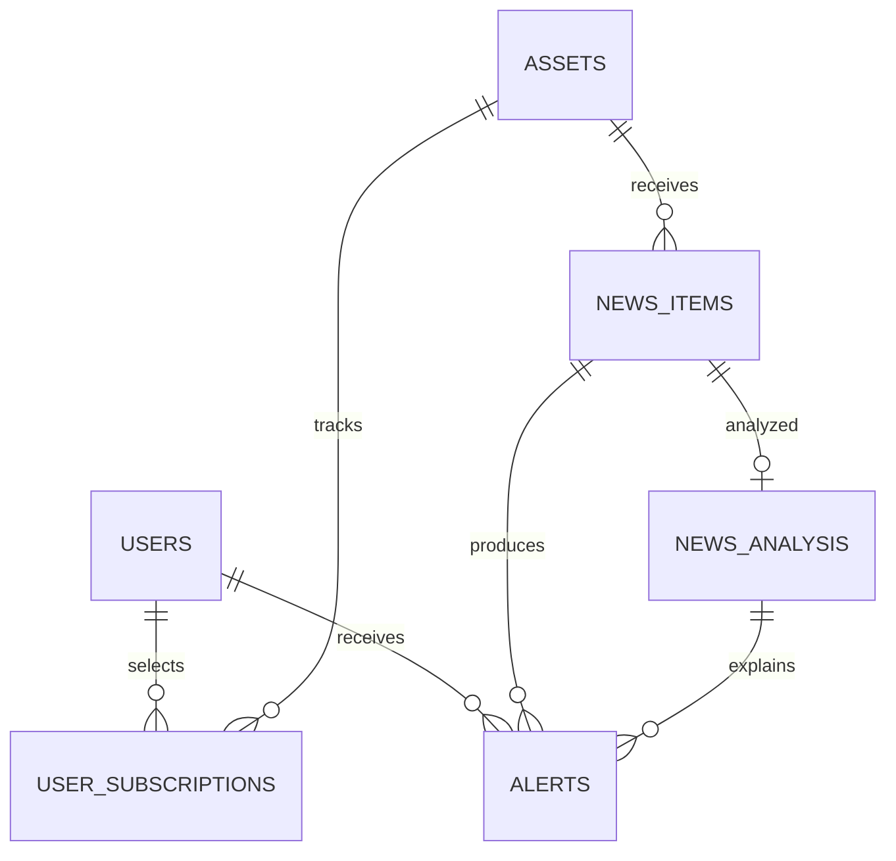

# Модель данных

| Таблица | Назначение | Уникальность |
| --- | --- | --- |
| `users` | Пользователи Telegram | `telegram_id` |
| `assets` | Компании и тикеры | `ticker` |
| `user_subscriptions` | Подписки пользователя на компанию | `user_id`, `asset_id` |
| `news_items` | Новости из Finnhub | `external_id` |
| `news_analysis` | Структурированный анализ новости | `news_id` |
| `alerts` | Текст и состояние отправки | `user_id`, `news_id` |

Начальная схема: [schema.sql](schema.sql). Исходное описание: [data-model.docx](../docs/models/data-model.docx); изображение из него: [data-model.png](../docs/models/data-model.png).

Таблицы связаны внешними ключами. Временные поля используют `TIMESTAMPTZ`; очереди новостей и подписки имеют индексы. В схему включены пять компаний MVP.

Одна новость сейчас связана с одним активом, а внешний ID уникален во всей новостной таблице. Поддержка нескольких компаний в одной новости потребует отдельной связи и миграции.

`schema.sql` описывает новый экземпляр БД. История миграций существующей базы пока не реализована; эта схема не заменяет миграцию данных.
