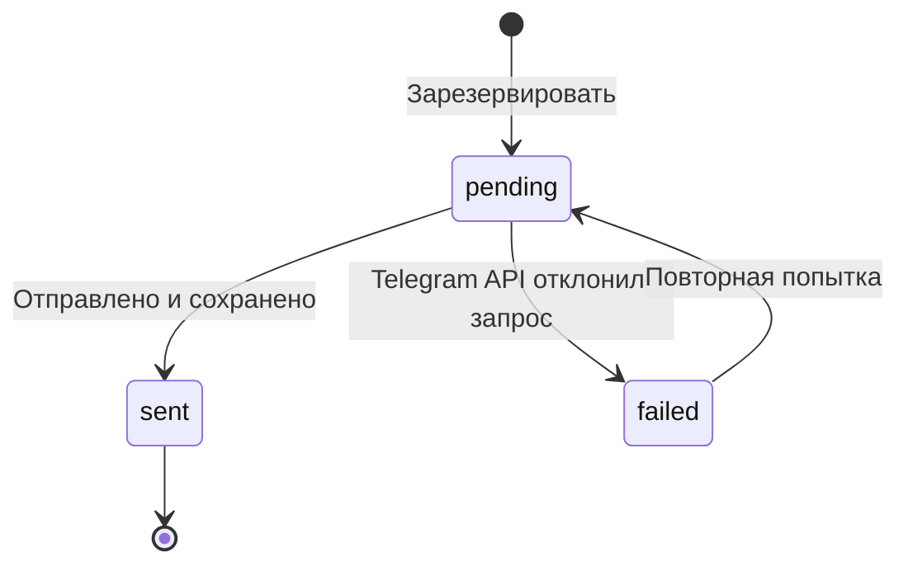

# Архитектура

## Компоненты

| Компонент | Файл | Ответственность |
| --- | --- | --- |
| Telegram-приложение | [bot/app.py](../src/money_market_alert/bot/app.py) | `/start`, меню, выбор компаний и остановка подписок |
| Формат уведомления | [bot/messages.py](../src/money_market_alert/bot/messages.py) | Понятный текст с ограничением длины |
| Доставка | [bot/notifications.py](../src/money_market_alert/bot/notifications.py) | Резервирование, отправка и сохранение результата |
| Finnhub | [services/finnhub.py](../src/money_market_alert/services/finnhub.py) | Получение новостей компаний |
| Ollama | [services/ollama.py](../src/money_market_alert/services/ollama.py) | Промпт, вызов модели и обработка ответа |
| Проверка анализа | [analysis/validation.py](../src/money_market_alert/analysis/validation.py) | Упоминание компании, JSON Schema и валидация |
| PostgreSQL | [storage/postgres.py](../src/money_market_alert/storage/postgres.py) | Пользователи, подписки, новости, анализ и отправки |
| Pipeline | [pipeline.py](../src/money_market_alert/pipeline.py) | Один цикл сбора, анализа и доставки |
| Планировщик | [scheduler.py](../src/money_market_alert/scheduler.py) | Последовательное повторение циклов |
| Настройки | [config.py](../src/money_market_alert/config.py) | Переменные окружения и журналирование |

Telegram-интерфейс и обработка новостей отделены друг от друга. Бот меняет подписки в БД, pipeline использует эти подписки при выборе получателей. Finnhub и Ollama вызываются последовательно: для текущего объёма MVP это сохраняет простую структуру.

## Обработка новости

1. Получить новости по активным компаниям за настроенное окно времени.
2. Сохранить новые внешние ID в PostgreSQL; повторы пропустить.
3. Выбрать необработанные записи от старых к новым.
4. Проверить явное упоминание тикера, названия или известного псевдонима компании.
5. Получить структурированный анализ Ollama и проверить его поля.
6. Сохранить анализ; для релевантных `medium` / `high` выбрать активных подписчиков.
7. Зарезервировать отправку, сформировать сообщение и сохранить результат доставки.

Период и размеры партий задаются настройками. Циклы в одном планировщике не перекрываются; если обработка длится дольше интервала, следующий цикл начинается после её завершения.

## Контракт LLM

| Поле | Тип / значения |
| --- | --- |
| `is_relevant` | `boolean` |
| `sentiment` | `positive`, `negative`, `neutral` |
| `importance` | `low`, `medium`, `high` |
| `short_summary` | Краткое содержание |
| `reasoning` | Объяснение классификации |
| `possible_impact` | Возможное влияние на восприятие компании |

Ollama получает JSON Schema и правила анализа. Python проверяет точный набор полей, boolean, допустимые классы и непустые текстовые значения. Нерелевантной новости задаются `neutral` и `low`. Неподходящий ответ не записывается как корректный анализ.

Структурная проверка не оценивает достоверность и качество текста. Для оценки модели требуется отдельный набор размеченных новостей.

## Доставка

`claim_alert()` атомарно разрешает новую отправку либо повтор ранее подтверждённой ошибки. Уже существующие `pending` и `sent` не получают нового разрешения. При сетевой неопределённости или сбое БД после принятия сообщения запись остаётся `pending`: автоматический повтор мог бы создать дубль.

Это учёт попыток доставки, а не гарантия ровно одного сообщения при любых сбоях. Управление зависшими состояниями и постоянными ошибками входит в план дальнейшей работы.

## Проверки

Автономные тесты охватывают границы слов в фильтре, проверку JSON, длинный текст и emoji, ошибки Telegram, резервирование и параметры планировщика. HTTP и Telegram имитируются. Отдельный сценарий PostgreSQL проверяет сохранение подписки и новости, повтор ID, анализ, смену статусов и конкурентное резервирование.
